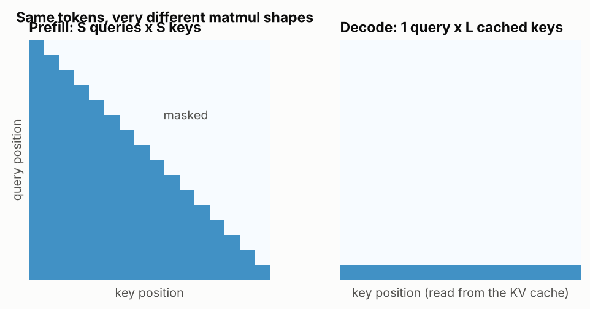
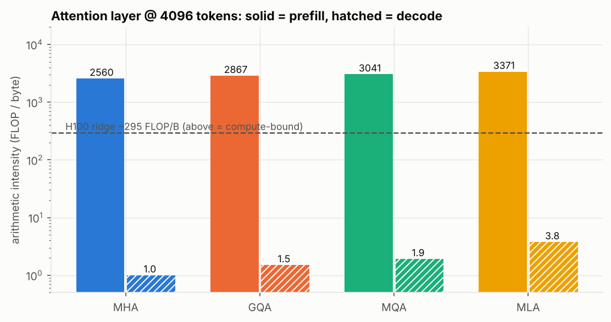
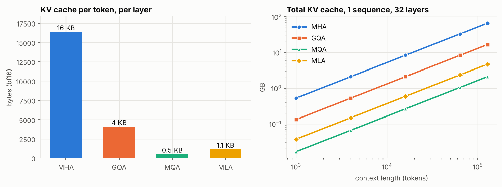
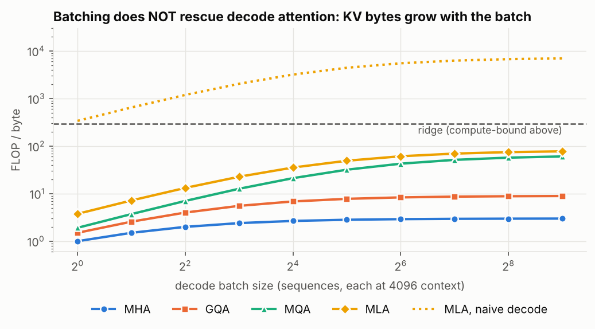
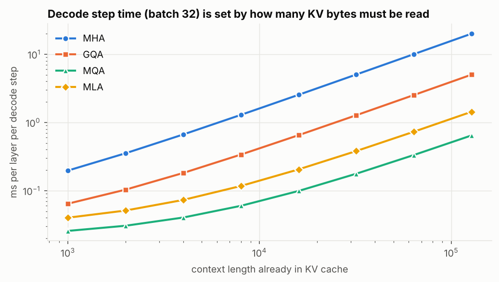
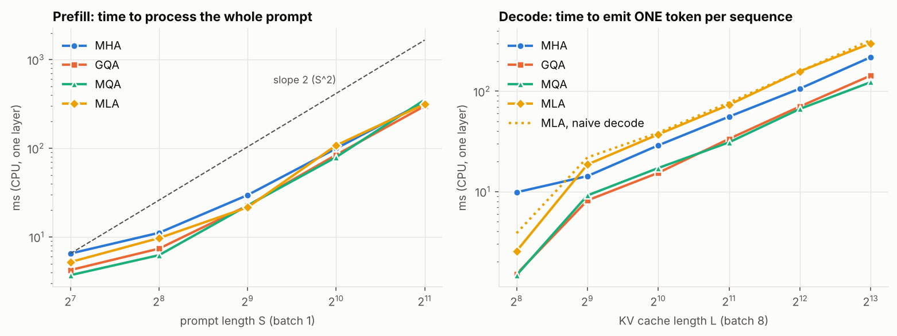
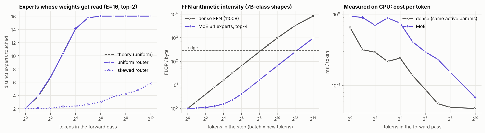

# Prefill vs decode across MHA / GQA / MQA / MLA / MoE

**No model or weights needed.** Prefill-vs-decode behaviour comes from tensor *shapes* (how many
tokens go through the matmuls, how many cached bytes must be read), not from trained values. So
everything here is plain PyTorch matmuls with random weights, plus an analytical cost model.
The tests prove the from-scratch code is a real attention implementation: prefill + token-by-token
decode reproduces a full causal forward pass to ~1e-7.

```
pip install -r requirements.txt
python test_equivalence.py   # prefill+decode == full forward; MLA absorbed == naive; MoE per-token == batched
python experiments.py        # ~40 s on CPU -> figures/*.png, results.json, results.md
```

| file | what |
|---|---|
| `attention.py` | `GroupedAttention` (MHA/GQA/MQA via `n_kv_heads`), `MultiHeadLatentAttention` (naive + absorbed), `MoEFFN`, RoPE, KV-cache `prefill()` / `decode()` |
| `analysis.py` | per-layer FLOPs / bytes / arithmetic intensity / roofline time (7B-class shapes, bf16, H100-like numbers) |
| `experiments.py` | validation, CPU measurements, all figures |

## Two kinds of evidence (keep them separate in the article)
* **Measured** (this machine, CPU, fp32, small shapes): FLOP counts from `torch.utils.flop_counter`,
  real cache tensor sizes, wall-clock latency, experts touched by the MoE router.
* **Modelled** (7B-class shapes, bf16, H100 roofline): bytes moved and arithmetic intensity. The model's FLOPs and
  cache bytes match torch's counter **exactly** (table in `results.md`), but the GPU time/intensity numbers are
  a roofline estimate, **not** a GPU measurement.

## What differs, same input
| | prefill (S tokens at once) | decode (1 token, L cached) |
|---|---|---|
| attention matrix | S x S lower triangle (`fig0`) | 1 x L row |
| big matmuls | GEMMs: weights reused across S tokens | GEMV-like: weights + whole KV cache read for 1 token |
| attention FLOPs | O(S^2) (measured slope ~2, `fig4` left) | O(L), linear (`fig4` right) |
| KV cache | **written** | **read** (+1 row appended) |
| bound by | compute (intensity ~2.5-3.4k FLOP/B >> ridge ~295) | memory (intensity ~1-4 FLOP/B) |




## Per variant
KV cache per token per layer (32 heads x 128, 8 KV heads for GQA, MLA r=512 + 64 rope; bf16): MHA 16 KB, GQA 4 KB,
MQA 0.5 KB, MLA 1.1 KB (`fig1`). The variants have nearly identical **prefill** cost (same projections, same S^2 scores,
`fig4` left) - they differ in the cache they leave behind and in **decode**.

* **MHA** - decode intensity = 1 FLOP/B at B=1 and saturates at ~3 as batch grows (`fig5`): every extra sequence brings its own huge KV cache, so batching never makes it compute-bound.
* **GQA / MQA** - shrink the cache 4x / 32x; decode bytes and (modelled) step time drop accordingly (`fig3`), intensity ceiling rises to ~9 / ~60.
* **MLA** - caches a 576-wide latent (14x smaller than MHA). To get the benefit in decode you must use the *absorbed* form (fold `W_uk` into q, `W_uv` after attention) so attention runs on the latent directly, like MQA with one wide KV head. Decoding naively (decompress the whole cache every step) is ~90x more FLOPs (3.5e10 vs 3.8e8 per layer at L=4096) - it cannot beat the memory wall. Conversely, **absorbed prefill costs ~1.7x the FLOPs of naive prefill**, so MLA is naturally used in *different forms* for the two phases. Intensity ceiling ~80 FLOP/B: the closest of the four to the ridge.
* **MoE (an FFN, not attention)** - prefill sends thousands of tokens through, so every expert is hit and weights are amortised: it behaves like a dense FFN with a big weight footprint. In decode, a step with T tokens only touches ~E(1-(1-k/E)^T) experts (`fig6` left), yet each token still pays top-k experts' compute, so intensity stays ~1 up to a few tokens and needs far larger batches than a dense FFN to reach the ridge (`fig6` middle). Memory *capacity* is the full E experts either way. With a skewed router fewer experts are touched (curve is router-dependent; ours is synthetic).







## Caveats - read before quoting numbers
1. **CPU timings do not reproduce the GPU story.** A CPU's ridge point is ~1-10 FLOP/B (vs ~295 on H100), so CPU decode is
   partly *compute*-bound. That is why in `fig4` the measured MLA-absorbed decode is *slower* than MHA/GQA: absorbed MLA does
   ~4.5x more attention FLOPs per cached token (width 1152 vs 256) in exchange for fewer bytes. On a GPU that trade wins
   (`fig3`, modelled); on this CPU it does not. Measured decode/prefill per-token ratio here is only ~9-10x for the same reason (on GPUs it is far larger).
2. Our torch decode `torch.cat`s the cache every step (copies it) and `repeat_interleave`s KV for GQA; real engines preallocate/page the cache and use fused kernels. This inflates absolute decode times, not the shapes of the curves.
3. Roofline intensity assumes FlashAttention-style fusion (score matrix never hits HBM) and ignores kernel efficiency, L2 effects, tensor parallelism and quantised KV.
4. At B=1, L=4096 weights (not KV) dominate decode bytes (KV share: MHA 33%, GQA 17%, MQA 3%, MLA 5%); KV dominates as batch and context grow, which is what `fig3`/`fig5` show.
5. MLA here omits the q-LoRA down/up projection, and MoE omits shared experts and load-balancing; random weights/inputs, so routing is synthetic. Small timings (< ~10 ms) are noisy (median of 3-5 runs).
